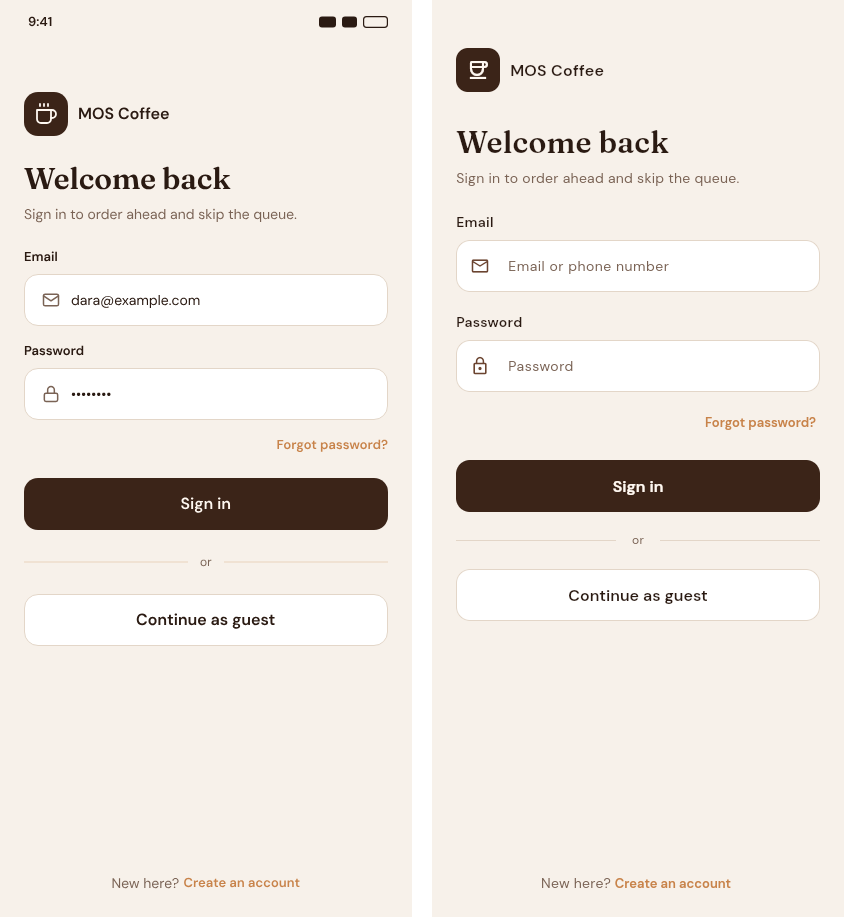
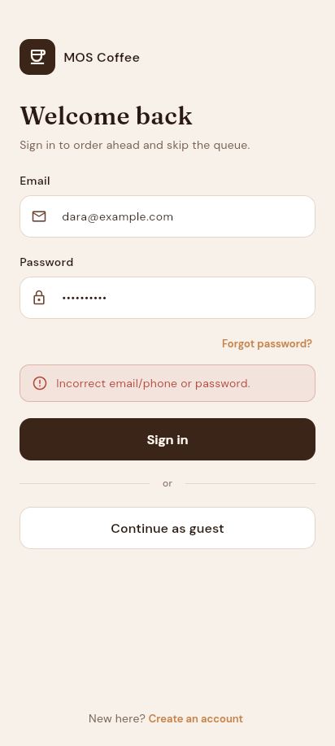

# MOS Coffee — Customer App

Flutter customer app for the **Mobile Ordering System (MOS)**, SV34 Mobile Application II, Team 4.
The requirements and design are in the SA document `Mobile-Ordering-System_2.0` (kept outside this repo, in `MOS/Documentation/`).

## Requirements

| Tool | Version |
|---|---|
| Flutter | 3.41.6 (stable) |
| Dart | 3.11.4 |
| Android | 10 (API 29) or above, per NFR-08 |

## Run

```bash
flutter pub get
flutter run              # pick an Android emulator / device
flutter test             # unit and widget tests
flutter analyze          # lints
```

To preview in a browser: `flutter run -d chrome`.

## Project structure

```
lib/
├── main.dart            # entry point
├── app.dart             # MaterialApp + theme + router
├── router.dart          # all routes (go_router)
├── core/
│   ├── theme/           # SA 4.1 design guidelines: colors (DG-C*), text styles (DG-F*), ThemeData
│   ├── utils/           # small helpers (form validators)
│   └── widgets/         # widgets shared across features
├── data/
│   ├── models/          # User, ... (mirror the SA data dictionary)
│   ├── repositories/    # abstract interfaces the UI depends on (NFR-09)
│   └── mock/            # in-memory implementations used until the backend exists
└── features/
    ├── auth/            # login page + AuthController (session state)
    ├── shell/           # bottom navigation (Home / Menu / Orders / Profile)
    ├── home/  menu/  orders/  account/
```

### How the layers talk

`Screen` → `Controller` (ChangeNotifier, via provider) → `Repository` interface → `Mock…Repository` today, `Api…Repository` later.
Only `main.dart` chooses the implementation, so switching to the real API does not touch any screen.

### Shared modules

| Module | Purpose |
|---|---|
| `core/theme/app_colors.dart` | The 14 theme colors from SA 4.1.2. Never write hex codes in widgets. |
| `core/theme/app_text_styles.dart` | The 8 text styles from SA 4.1.1. |
| `core/theme/app_theme.dart` | Turns the two files above into `ThemeData`, so plain Material widgets match the Figma design. |
| `core/utils/validators.dart` | Email / Cambodian phone checks for every form. |
| `core/widgets/labeled_text_field.dart` | Label + icon text field used by the auth and profile forms. |
| `core/widgets/or_divider.dart` | The "— or —" line between two actions. |

## Demo accounts (mock data)

All use the password `password123`.

| Account | Result |
|---|---|
| `dara@example.com` or `012 345 678` | Customer, signs in |
| `098 765 432` | Customer (phone only), signs in |
| `inactive@example.com` | Deactivated, refused |
| `staff@mos.coffee` | Staff, refused: staff use the admin dashboard (FR-05) |

## Screenshots

| Login vs Figma | Wrong password (TC-04) |
|---|---|
|  |  |

## Fonts

Fraunces and DM Sans are bundled in `assets/fonts/` (SIL Open Font License 1.1) so the app looks the same offline.

## Git workflow

`main` only holds verified code. Each feature is built on `feature/<name>`, verified, then merged through a pull request.
